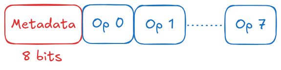

## [DKC:TF](../../formats.md#dkctf) > Compression

Texture, model and material data can be compressed. The buffer has the following format:

| Offset | Size | Description |
| --- | --- | --- |
| 0x0 | 1 | [Compression algorithm](#compression-algorithms) |
| 0x1 | 3 | Padding |
| 0x4 | | Compressed data |

## Compression Algorithms
| Value | Algorithm |
| --- | --- |
| 0 | Not compressed |
| 1 | [LZSS 8-bit](#lzss) |
| 2 | [LZSS 16-bit](#lzss) |
| 3 | [LZSS 32-bit](#lzss) |
| 4 | LZSS 8-bit arithmetic |
| 5 | LZSS 16-bit arithmetic |
| 6 | LZSS 32-bit arithmetic |
| 7 | LZSS 8-bit 3-byte |
| 8 | LZSS 16-bit 3-byte |
| 9 | LZSS 32-bit 3-byte |
| 10 | LZSS 8-bit 3-byte arithmetic |
| 11 | LZSS 16-bit 3-byte arithmetic |
| 12 | LZSS 32-bit 3-byte arithmetic |
| 13 | Zlib |

## LZSS
LZSS is available in 8-bit, 16-bit and 32-bit variants. This is the word size on which the LZSS algorithm operates.

During decompression, the input stream is divided into blocks. Every block starts with an 8-bit integer. Every bit in this integer specifies an action that is performed during decompression. The most significant bit is processed first. Blocks are processed until the end of the input stream is reached.

If the operation bit is 0, the next word of the input stream is copied to the output stream verbatim.

If the operation bit is 1, an earlier part of the output stream is duplicated and appended to the output stream. First, a 16-bit big-endian integer is read from the input stream. The 4 most significant bits indicate the number of words that are copied, minus a constant. The constant depends on the word size:

| Word size | Addend |
| --- | --- |
| 8 bits | 3 |
| 16 bits | 2 |
| 32 bits | 1 |

The 12 least significant bits indicate the distance from the end of the output stream, measured in words.

### Example
Consider the following situation:
* Word size: 8 bits
* Next operation: 1
* Current output stream: `Time flies like an arrow, fruit`
* Remaining input stream: `a01b...`

Because the operation bit is 1, a 16-bit big-endian integer is read from the stream: `0xA01B`. 

The number of characters that are copied is `(0xA01B >> 12) + 3 = 13` words.

The offset from the end of the output stream to the characters that are copied is `0xA01B & 0xFFF = 27` words.

Therefore, the following characters are copied to the end of the output stream: `" flies like a"`.

The output stream now contains the data `Time flies like an arrow, fruit flies like a`.

### Implementation
An implementation of the LZSS algorithm can be found [here](https://github.com/kinnay/ninty/blob/master/src/module_lzss.cpp).
